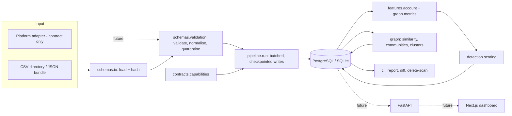

# Architecture

This describes what is built today, what is planned, and why the shape is what it is. Where the
master specification and the code differ, the difference is listed under "Deviations from the
specification" and has a decision record.

## Built vs. planned

| Area | State |
|---|---|
| Dataset import, validation, quarantine | Built, tested |
| PostgreSQL schema and migrations | Built; the SQL runs on SQLite in tests, **never run on PostgreSQL** |
| Account features, rules scoring, evidence | Built, tested |
| Graph similarity, communities, candidate clusters, scan comparison | Built, tested |
| Scan state machine, checkpoints, resume, retention | Built, tested |
| Capability registry and adapter contract | Built; **no live adapter exists** |
| CLI | Built |
| FastAPI service, authentication, RBAC, export | **Not built** (Phase 4) |
| Next.js dashboard | **Not built** (Phase 4) |
| Live platform adapters | **Not built** (Phase 5/6) |
| Terraform, Cloud Run, Cloud SQL, CI/CD deploy | **Not built** (Phase 8); a CI workflow for checks is written but has never run |
| Cloud Tasks / Pub/Sub workers | **Not built**; the pipeline currently runs in-process |

## Component view

## Module map

| Spec area | Module | Responsibility |
|---|---|---|
| `packages/platform_contracts` | `sbh.contracts` | Platform enum, capability registry, `PlatformAdapter` protocol, `AccessOutcome` |
| `packages/schemas` | `sbh.schemas` | Record types, manifest, file loading, validation and normalisation |
| `workers/collection` (dataset import) | `sbh.pipeline.run` | Scan orchestration: state machine, batching, checkpoints, resume |
| `workers/feature_engineering` | `sbh.features` | Interpretable per-account features |
| `workers/detection` | `sbh.detection`, `sbh.graph.clusters` | Risk scoring; candidate cluster detection |
| `packages/graph_analysis` | `sbh.graph` | Graph build with limits, similarity, communities, temporal sync, scan diff |
| `packages/shared` | `sbh.shared` | Errors, time, JSON, retry, logging, sanitising |
| `db/` | `sbh.storage`, `db/migrations` | Database wrapper, migration runner, repositories, retention |
| (none) | `sbh.docgen` | Generates the doc tables that come from code |
| `.agents/rules` | `.agents/rules/*.md` | Development rules for coding agents |

Repository classes are the only code that writes SQL. `features`, `detection` and `graph` are pure
functions over plain data, which is why they are cheap to test exhaustively.

## Data flow of one scan

1. **Load and hash** the input. Reject unreadable input before any scan row exists (audited).
2. **Check the capability registry.** Dataset import must be `implemented` for the platform.
3. **Idempotency.** Look the input hash up. Already imported: return the existing result. Failed:
   resume. Running: refuse unless explicitly forced. Cancelled: refuse.
4. **Create the scan** (`pending` to `running`) and its `dataset_imports` row in one transaction.
5. **Validate and normalise.** Rejected rows go to `quarantined_records`. If the rejected share
   exceeds `max_invalid_fraction`, fail the scan before importing anything.
6. **Persist in batches.** Accounts, observations, edges, content: each batch commits together with
   its checkpoint. Then relationship-list coverage.
7. **Features.** One feature row per account per feature, available or not.
8. **Detection.** Register the rules `model_versions` row, score each account, write assessments and
   evidence records.
9. **Clusters.** Register the graph `model_versions` row, detect candidates, write clusters,
   memberships and evidence.
10. **Finish.** `complete` only if nothing was rejected, nothing was skipped and every list is
    declared complete; otherwise `partial`, with the reasons stored on the scan.

## Failure handling

| Failure | Behaviour |
|---|---|
| Exception in any stage | Open transaction rolls back; scan goes `failed` with the reason; audit event written. The batch that failed leaves no rows. |
| Crash of the whole process | Scan stays `running`; rerun refuses unless `allow_resume_running` is set by an operator. |
| Rerun after `failed` | Resumes from the last committed checkpoint; the result is identical to an uninterrupted run (tested). |
| Same input again | No-op; returns the stored result. |
| Invalid rows | Quarantined with reasons; the scan is at best `partial`. |
| Too many invalid rows | Scan fails before importing; quarantine is kept for inspection. |
| Graph limit exceeded | Network features unavailable, no clusters, scan `partial`; the data is kept. |
| Analysis stage re-run | Derived rows are replaced per (scan, version) in one transaction. |

Pipeline failures are recorded on the scan. They are never turned into findings about accounts.

## Trade-offs

* **Single Python distribution instead of many packages.** One `sbh` package with clear module
  boundaries is simpler to test and version at this size. Split when a deployable unit needs it
  (ADR-0001).
* **One portable SQL file for two databases.** Lets the tests run the real migration without a
  PostgreSQL server, at the cost of avoiding some PostgreSQL-specific features (ADR-0002).
* **Per-scan snapshots of edges** rather than one mutable "current edge" table. More storage, but
  history and honest comparison come for free, and there is no state to corrupt (ADR-0003).
* **NetworkX, in memory, one graph per scan.** Measured at 60k edges in about 3.5 s. No graph
  database or PySpark until measurements on real workloads justify them (see `testing-and-validation.md`).
* **Rules before machine learning.** There are no labels, so a model would have nothing honest to
  learn from (ADR-0004).

## Deviations from the specification

| Specification | Here | Why |
|---|---|---|
| Multi-package monorepo (`packages/*`, `workers/*`) | One package `sbh` | ADR-0001 |
| Pydantic models | Frozen dataclasses and hand-written validation in the core | Keeps the core dependency-light and testable offline; Pydantic arrives with FastAPI in Phase 4 |
| `network_clusters` "confidence" | Ordinal `low` / `moderate` / `high`; the algorithm never emits `high` | There is no calibration data for numeric confidence |
| `scan_checkpoints` | Column `cursor_pos` instead of `cursor` | `CURSOR` is a SQL keyword; avoiding it keeps the schema portable |
| Table list in section 6.5 | Plus `relationship_list_coverage` and `quarantined_records` | Needed for honest comparison and for not discarding invalid rows |
