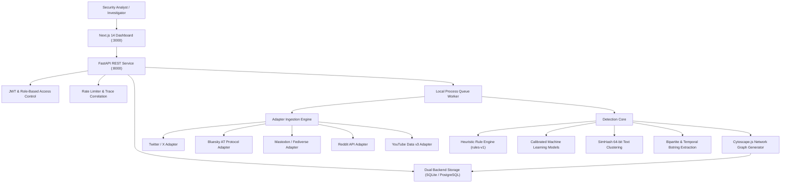

# Social Bot Hunter - System Architecture & Engineering Topology

This document describes the high-level architecture, module decomposition, and data flow of Social Bot Hunter v1.0.0.

## 1. System Topology Overview

## 2. Core Architectural Principles
1. **Explainability First**: Every computed score is accompanied by transparent signal contributions, component breakdowns, and alternative explanations.
2. **Offline Isolation & Air-Gapped Operation**: The entire platform operates in a local `.venv` using local filesystem snapshots (`data/snapshots/`) and SQLite/PostgreSQL with zero external cloud dependencies.
3. **Data Provenance & Privacy**: Ingested datasets track SHA-256 content hashes, actor metadata, and timestamps. Personal Identifiable Information (PII) is automatically anonymized with HMAC-SHA256.
4. **Idempotence & Crash Recovery**: Ingestion and scan processing are atomic and transactional. Workers recover gracefully from crashes using SQLite/PostgreSQL state machines.
